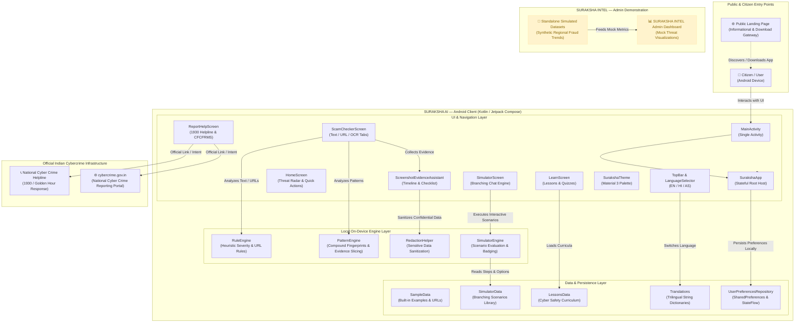

# SURAKSHA AI — System Architecture & Technical Specifications

## 1. System Overview

**SURAKSHA AI** is a mobile-first cyber defense utility designed to empower Indian citizens against cyber fraud, financial extortion, phishing, and recruitment scams.

The broader project concept encompasses three distinct functional tiers:
1. **Public Landing Page**: An external web presentation layer designed for public discovery, campaign awareness, and distribution of the mobile APK.
2. **Citizen-Facing Mobile Application (`Suraksha AI`)**: The core Android application implemented in this repository, providing on-device scam checking, interactive branching conversation simulation, screenshot timeline evidence collation, structured cyber literacy lessons, and emergency helpline guidance (1930 / cybercrime.gov.in).
3. **SURAKSHA INTEL Demonstration Dashboard**: A separate, administrative threat intelligence dashboard for public safety officers. **Important**: In the current implementation, SURAKSHA INTEL operates exclusively with simulated mock datasets. There is **no live telemetry, backend API bridge, or network connection** between the citizen mobile app and SURAKSHA INTEL.

---

## 2. High-Level Architecture Diagram



---

## 3. Component Breakdown and Responsibilities

### 3.1 UI & Navigation Layer
- **`MainActivity.kt`**: Single-activity entry point. Configures edge-to-edge window insets and delegates to `SurakshaApp`.
- **`SurakshaApp.kt`**: Central orchestration composable. Maintains active navigation tabs (`HOME`, `SCAM_CHECKER`, `SIMULATOR`, `LEARN`, `REPORT_HELP`, `SETTINGS`), sheet modals (`LanguageSelectorModal`, `AiConsentModal`), sub-screens (`PrivacyScreen`, `FeedbackScreen`), and backstack handling.
- **`HomeScreen.kt`**: Civic cyber dashboard highlighting the National Emergency Helpline 1930, daily threat advisories, quick scan entry points, and educational progress metrics.
- **`ScamCheckerScreen.kt`**: Multi-modal citizen analysis interface featuring:
  - Text input tab for SMS, WhatsApp, and email messages with one-click test samples.
  - Link input tab for URL and domain inspection.
  - Screenshot Evidence Assistant tab for visual evidence extraction and timeline generation.
- **`SimulatorScreen.kt`**: Educational chat-based simulation of real-world scam conversations. Features interactive multi-step choices, immediate feedback, scoring, red-flag explanations, and badge awards.
- **`LearnScreen.kt`**: 8 modular cybercrime literacy lessons with multiple-choice comprehension quizzes.
- **`ReportHelpScreen.kt`**: Direct emergency guidance detailing Golden Hour financial fraud recovery, steps to call 1930, evidence checklists, and official links to `cybercrime.gov.in`.

### 3.2 Detection & Analysis Engines (100% On-Device)
- **`RuleEngine.kt`**: Deterministic rule matcher that calculates severity scores and extracts specific rule violations:
  - *Text Signals*: Sensitive credentials (OTP, UPI PIN, passwords), upfront/advance fees, threats of arrest/suspension, artificial urgency, fake lottery/cashback, unverified sender handles.
  - *URL Signals*: Suspicious top-level domains (`.xyz`, `.top`, `.ga`, etc.), brand name impersonation (`sbi`, `hdfc`, `paytm`, `amazon`), embedded credentials (`@`), IP-based hosts, and URL shorteners.
- **`PatternEngine.kt`**: Compound pattern fingerprinting engine. Identifies coordinated scam strategies rather than isolated words. Separates **directly observed evidence** from **inferred possibilities** and returns one of 5 distinct fingerprints:
  1. `FP_ADVANCE_FEE_JOB`: Fake job promise + Upfront registration fee + Urgency.
  2. `FP_BANK_CREDENTIAL_HARVESTING`: Bank authority impersonation + Deceptive link + OTP request.
  3. `FP_PREDATORY_LOAN_FEE`: Instant loan claim + Upfront processing fee + Personal UPI handle routing.
  4. `FP_INVESTMENT_PRIZE_TRAP`: High-yield reward/lottery claim + Upfront clearance fee.
  5. `FP_REMOTE_DEVICE_TAKEOVER`: Screen-sharing instruction (AnyDesk, TeamViewer) + Support impersonation.
  - *Benign Match*: `FP_BENIGN_LEGITIMATE` for non-fraudulent transactional messages.
  - *Inconclusive Match*: `FP_INCONCLUSIVE` for brief, ambiguous, or unformatted input.
- **`RedactionHelper.kt`**: Client-side regex engine that masks confidential OTPs, 16-digit debit/credit card numbers, and 12-digit Aadhaar identifiers before text is reviewed or exported.
- **`SimulatorEngine.kt`**: State machine managing branching narrative progression, point scoring (0–100), red-flag tracking, and competency badge calculation.

### 3.3 Data & Storage Layer
- **`UserPreferencesRepository.kt`**: Lightweight local persistence using Android `SharedPreferences`. Stores:
  - Chosen application language (`en`, `hi`, `as`).
  - Completed lesson IDs (`Set<String>`).
  - Completed simulation IDs (`Set<String>`).
  - AI consent preference (`Boolean`).
  - Offline feedback records (`List<FeedbackItem>`).
- **No Cloud Database or Remote Server**: The app does not transmit submitted messages or citizen records to any server.

---

## 4. User Journey: Discovery to Protection

```
[Public Landing Page / Discovery]
              │
              ▼
   [Download & Launch Android App]
              │
              ▼
    [Home Safety Dashboard]
   ├── View 1930 Helpline & Golden Hour Advisories
   ├── Choose Preferred Language (English / Hindi / Assamese)
   │
   ├── Option A: Scam Checker
   │     ├── Paste Suspicious Message / URL
   │     ├── Review Detected Pattern Fingerprint & Observed Evidence
   │     └── Follow Recommended Safe Next Steps (Do not pay, do not click)
   │
   ├── Option B: Scam Simulator
   │     ├── Select Scenario (Job Offer, Bank OTP, UPI Trap)
   │     ├── Practice Live Chat Decision-Making
   │     └── Review Mistakes, Red Flags, and Safety Score
   │
   ├── Option C: Screenshot Evidence Assistant
   │     ├── Select Screenshot via Photo Picker (Zero-Permission)
   │     ├── Extract / Manually Input Text
   │     ├── Redact OTPs & Card Details
   │     └── Generate Incident Timeline & Downloadable Summary
   │
   └── Option D: Emergency Reporting Help
         ├── One-touch dial to 1930
         └── Checklist for filing on cybercrime.gov.in
```

---

## 5. Real Analysis Method Currently Used

### Classification: Deterministic Heuristic & Rule-Based Pattern Fingerprinting
The scam detection engine currently implemented in this repository is **100% on-device, deterministic, and rule-based**. It operates as follows:

1. **Input Normalization**: Strips excessive whitespace, extracts URLs using regex, and converts text to lowercase tokens while preserving the original string for context snippet extraction.
2. **Signal Extraction**: Multiple independent regex and vocabulary matchers scan for concrete indicators (credential extraction, advance fees, intimidation keywords, urgency indicators, personal payment endpoints).
3. **Evidence Separation**: Directly observed quotes are captured as `ObservedEvidence`. Inferred possibilities (hypotheses of what the scammer intends to do) are cleanly isolated to prevent confusing conjecture with evidence.
4. **Pattern Fingerprinting**: Rather than adding arbitrary numbers to produce an unvalidated probability score, the engine checks for specific combinations of primary triggers and corroborating signals to assign a named `PatternFingerprint` and risk tier (`HIGH_CONCERN`, `CAUTION`, `LOW_CONCERN`, `UNABLE_TO_ASSESS`).
5. **No Network Dependency for Core Analysis**: The core analyzer does not call remote web APIs or cloud LLMs to reach a verdict. This ensures 100% privacy, instantaneous response time, and offline usability.

---

## 6. SURAKSHA INTEL Separation & Simulated Architecture

### Explicit Verification Statement
The `SURAKSHA INTEL` administrative demonstration dashboard is a **conceptually separate demonstration component**.
- **Data Source**: Standalone mock and simulated datasets modeling regional cyber fraud trends across Indian states.
- **Live Integration Status**: **None**. There is no live telemetry pipeline, socket connection, or REST API bridge connecting the citizen Android app to SURAKSHA INTEL.
- **Privacy Guarantee**: Citizen scam checks performed inside the Android app remain strictly local to the device and are never forwarded to the admin dashboard.

---

## 7. Security Boundaries & Privacy Safeguards

1. **Zero-Permission Media Selection**: Uses the modern Android Photo Picker (`ActivityResultContracts.PickVisualMedia`) for screenshot selection, eliminating the need for broad storage permissions (`READ_EXTERNAL_STORAGE`).
2. **Local Sensitive Data Redaction**: `RedactionHelper` sanitizes OTPs, PINs, card numbers, and Aadhaar numbers before evidence summaries are collated.
3. **No Background Telemetry**: The app does not include analytics trackers, advertising SDKs, or background telemetry services.
4. **Offline Persistence**: User progress is stored exclusively in private application preferences (`MODE_PRIVATE`).
5. **No Claims of Automated Police Filing**: The app clearly advises citizens that reports must be submitted directly to official authorities (`1930` or `cybercrime.gov.in`) and never claims to lodge police FIRs automatically.

---

## 8. Known Limitations & Future Architecture Roadmap

| Area | Current Implementation | Planned Roadmap |
|---|---|---|
| **Text Analysis** | Deterministic rule matching & regex pattern fingerprinting. | Optional opt-in server-side Gemini AI for nuanced regional dialects and multi-turn scam analysis. |
| **OCR Text Extraction** | Local pre-analysis text editing and fallback manual entry. | On-device ML Kit Text Recognition for offline image OCR. |
| **Evidence Export** | Local text summary formatting and clipboard export. | PDF incident docket export with cryptographic hash timestamping. |
| **Threat Intelligence** | Static sample dictionary (`SampleData.kt`). | Privacy-preserving federated threat feeds with zero citizen telemetry. |
| **SURAKSHA INTEL** | Independent mock demonstration dashboard. | Fully opt-in, anonymized citizen reporting ingestion pipeline. |
